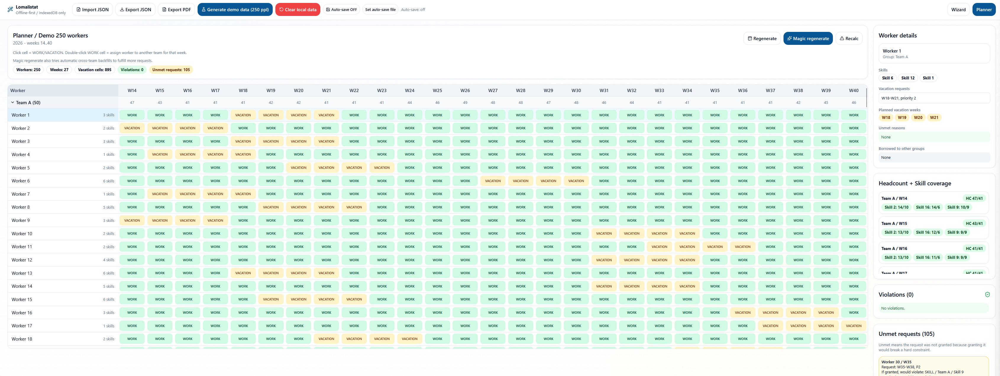
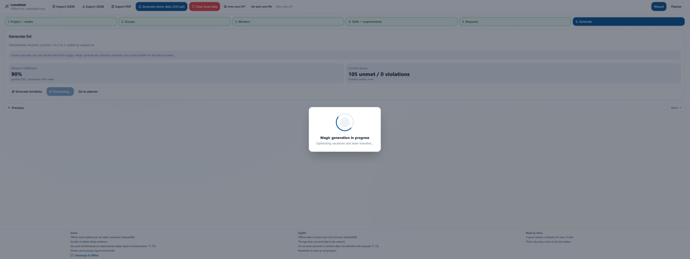

# Lomalistat (Vacation Planner)

Viikkotasoinen lomalistojen suunnittelutyokalu, taysin offline-first PWA.  
Data tallennetaan paikallisesti selaimeen (IndexedDB), eika projektidataa laheteta ulkoisiin palveluihin.  
Import/Export toimii JSON-tiedostolla.




---

## FI

### 1) Kuvaus

Lomalistat on viikkotason lomasuunnittelutyokalu, jossa:

- kaikki projektidata pysyy paikallisesti selaimessa
- suunnitelmaa voi rakentaa Wizardilla ja muokata Plannerissa
- projekti voidaan varmuuskopioida/siirtaa JSON Import/Export -toiminnolla

### 2) Keskeiset ominaisuudet

- Wizard (6 askelta): aikajakso, ryhmat, tyontekijat, taidot + vaatimukset, toiveet, generointi
- Planner: WORK/VACATION-taulukko, solun klikkaus muuttaa tilaa, rikkomukset paivittyvat reaaliajassa
- Ryhmavaihdot viikoille: WORK-solun tuplaklikilla tyontekija voidaan sijoittaa toiseen ryhmaan valitulle viikolle
- Hard constraints:
  - `group.minHeadcountPerWeek` per ryhma per viikko
  - `skillRequirements.minPerWeek` per ryhma per viikko
- Soft constraints:
  - lomatoiveet kasitellaan prioriteettijarjestyksessa `1 -> 2 -> 3` (1 = korkein)
- Demo-nappi: luo deterministisen demoprojektin seedilla `1337` (nykyinen demo: 250 hlo)
- Import/Export: `Project.json` sisaltaa koko projektin
- Reset: tyhjentaa paikallisen IndexedDB-datan
- Magic-generate: yrittaa toteuttaa enemman toiveita myos automaattisilla ryhmasiirroilla

### 3) Tietosuoja ja offline-periaate

Tarkeaa:

- Sovelluskoodi ei tee verkkokutsuja projektidatalle (`fetch`, `axios`, `websocket`), eika kayta analytiikkaa/telemetriaa.
- Kaikki projektidata tallentuu paikallisesti selaimen IndexedDB:hen.
- Ainoa tarkoituksellinen tiedonsiirto on kayttajan oma Import/Export JSON-tiedosto.
- Ala syota henkilotietoja tai arkaluontoista dataa. Kayta tunnisteita (esim. `T1`, `T2`).
- Varmuuskopioi data saannollisesti Export-toiminnolla.

### 4) Asennus ja ajo

```bash
npm install
npm run dev
npm run test
npm run lint
npm run build
npm run preview -- --port 4174
```

### 5) PWA / Offline testaus

- Testaa ensisijaisesti build + preview -tilassa, ei pelkastaan dev-tilassa.
- Avaa selaimen DevTools:
  - `Application -> Service Workers`: varmista etta service worker on rekisteroity
  - `Network -> Offline`: paivita sivu, sovelluksen tulee avautua offline-tilassa

### 6) Dataformaatti (Project.json v1)

Project.json (schemaVersion `1`) sisaltaa:

- `schemaVersion`
- `project`
- `timeWindow`
- `groups`
- `skills`
- `skillRequirements`
- `workers`
- `requests`
- `plan`
- `violations`
- `unmetRequests`

Huom:

- `schemaVersion` + migraatiot mahdollistavat myohemmat formaattimuutokset.
- `plan` sisaltaa viikkokohtaiset assignmentit seka mahdolliset ryhma-overridet.

### 7) Generointilogiikka (ENGINE, lyhyesti)

- Alustetaan kaikki `WORK`-tilaan
- Kasitellaan requestit prioriteettijarjestyksessa (1 ensin)
- Kokeillaan viikkokohtaisesti `VACATION`
- Muutos hyvaksytaan vain jos hard constraints tayttyvat
- Muuten muutos perutaan ja kirjataan unmet-syy
- Lopuksi lasketaan violations koko aikajaksolle
- Plannerin manuaalimuokkauksessa muutosta ei esteta, vaan rikkomukset lasketaan uudelleen

### 8) Projektirakenne

- `src/model`: domain-tyypit, validointi, migraatiot
- `src/engine`: constraints, generatePlan, recalc
- `src/repository`: IndexedDBRepo, InMemoryRepo
- `src/controller`: Zustand-store, import/export, demo-data
- `src/view`: Wizard + Planner UI

### 9) Lisenssi

All rights reserved. Internal tool.

#### Riippuvuudet ja kolmansien osapuolten lisenssit

Ylla oleva All rights reserved -ehto koskee projektin omaa koodia.
Kolmansien osapuolten kirjastot ja tyokalut sailyttavat omat lisenssinsa.
Alla olevat versiot ovat `package-lock.json`-tiedostoon lukitut versiot;
`package.json` maarittelee sallitut versioalueet.

**Sovelluksen suorat riippuvuudet**

| Riippuvuus | Lukittu versio | Lisenssi |
| --- | --- | --- |
| `class-variance-authority` | 0.7.1 | Apache-2.0 |
| `clsx` | 2.1.1 | MIT |
| `dexie` | 4.3.0 | Apache-2.0 |
| `lucide-react` | 0.544.0 | ISC + MIT (Feather) |
| `pdf-lib` | 1.17.1 | MIT |
| `react` | 19.2.4 | MIT |
| `react-dom` | 19.2.4 | MIT |
| `tailwind-merge` | 3.5.0 | MIT |
| `zustand` | 5.0.11 | MIT |

**Suorat kehitys-, testaus- ja build-riippuvuudet**

| Riippuvuus | Lukittu versio | Lisenssi |
| --- | --- | --- |
| `@types/node` | 24.11.0 | MIT |
| `@types/react` | 19.2.14 | MIT |
| `@types/react-dom` | 19.2.3 | MIT |
| `@typescript-eslint/eslint-plugin` | 8.56.1 | MIT |
| `@typescript-eslint/parser` | 8.56.1 | MIT |
| `@vitejs/plugin-react` | 5.1.4 | MIT |
| `autoprefixer` | 10.4.27 | MIT |
| `eslint` | 9.39.3 | MIT |
| `eslint-plugin-react-hooks` | 5.2.0 | MIT |
| `eslint-plugin-react-refresh` | 0.4.26 | MIT |
| `postcss` | 8.5.6 | MIT |
| `prettier` | 3.8.1 | MIT |
| `tailwindcss` | 3.4.19 | MIT |
| `typescript` | 5.9.3 | Apache-2.0 |
| `vite` | 7.3.1 | MIT |
| `vite-plugin-pwa` | 1.2.0 | MIT |
| `vitest` | 3.2.4 | MIT |
| `workbox-build` | 7.4.0 | MIT |

[THIRD_PARTY_NOTICES.txt](THIRD_PARTY_NOTICES.txt) sisaltaa alkuperaiset
lisenssitekstit ja tekijanoikeusilmoitukset sovelluksen suorille ja valillisille
riippuvuuksille, Workbox-paketeille seka ylla luetelluille suorille
kehitystyokaluille. Mukana ovat myos pakettien omat mukana toimitetun koodin
lisenssi-ilmoitukset, Dexien `NOTICE`, Luciden Feather-osuuksien MIT-ehdot
ja pakon zlib-ehdot. Kaikkia listattuja paketteja ei sisally jokaiseen buildiin.

Sailyta ilmoitustiedosto mukana, kun jaat sovelluksen lahdekoodia tai valmista
selainversiota. Vite ei kopioi projektin juuren tekstitiedostoa automaattisesti:
kopioi `THIRD_PARTY_NOTICES.txt` buildin jalkeen `dist`-hakemistoon ja jaa se
muiden build-tiedostojen mukana. Jos jaat kehitystyokaluja tai `node_modules`-
hakemiston, sailyta myos niiden valillisten riippuvuuksien alkuperaiset
lisenssi- ja tekijanoikeustiedostot. Paivita taulukot ja ilmoitustiedosto,
kun riippuvuudet tai lukitut versiot muuttuvat.

### 10) About

Made by Antsa  
Hyva lomalista ei nay, se tuntuu. Siksi jokainen nimi listalla merkitsee.

---

## EN

### 1) Description

Lomalistat is a weekly vacation planning tool built as an offline-first PWA:

- all project data stays local in the browser
- planning is done in Wizard and refined in Planner
- full project backup/transfer is done with JSON Import/Export

### 2) Key features

- Wizard (6 steps): time window, groups, workers, skills + requirements, requests, generate
- Planner: WORK/VACATION grid, click to toggle cells, real-time violation recalculation
- Weekly group reassignment: double-click a WORK cell to assign worker to another group for that week
- Hard constraints:
  - `group.minHeadcountPerWeek` per group per week
  - `skillRequirements.minPerWeek` per group per week
- Soft constraints:
  - vacation requests are processed by priority `1 -> 2 -> 3` (1 = highest)
- Demo button: deterministic seeded demo (`1337`, current demo size: 250 workers)
- Import/Export: `Project.json` contains the full project
- Reset: clears local IndexedDB data
- Magic generate: also tries automatic cross-group backfills to satisfy more requests

### 3) Privacy and offline principle

Important:

- The app code does not send project data over network APIs (`fetch`, `axios`, `websocket`) and does not use analytics/telemetry.
- All project data is stored only in local browser IndexedDB.
- The only intentional data transfer is user-controlled JSON Import/Export.
- Do not enter personal or sensitive data. Use identifiers (for example `T1`, `T2`).
- Back up regularly with Export.

### 4) Install and run

```bash
npm install
npm run dev
npm run test
npm run lint
npm run build
npm run preview -- --port 4174
```

### 5) PWA / Offline testing

- Prefer testing with build + preview, not only dev mode.
- In browser DevTools:
  - `Application -> Service Workers`: verify service worker is registered
  - `Network -> Offline`: refresh and verify app still loads

### 6) Data format (Project.json v1)

Project.json (`schemaVersion: 1`) includes:

- `schemaVersion`
- `project`
- `timeWindow`
- `groups`
- `skills`
- `skillRequirements`
- `workers`
- `requests`
- `plan`
- `violations`
- `unmetRequests`

Note:

- `schemaVersion` + migrations allow future data model changes.
- `plan` includes weekly assignments and possible group overrides.

### 7) Engine logic (short)

- Initialize all workers to `WORK`
- Process requests in priority order (1 first)
- Try setting requested weeks to `VACATION`
- Keep change only if hard constraints remain valid
- Otherwise revert and record unmet reason
- Recompute final violations after generation
- In Planner manual edits are not blocked; violations are recalculated after edit

### 8) Project structure

- `src/model`: domain types, validation, migrations
- `src/engine`: constraints, generatePlan, recalc
- `src/repository`: IndexedDBRepo, InMemoryRepo
- `src/controller`: Zustand store, import/export, demo-data
- `src/view`: Wizard + Planner UI

### 9) License

All rights reserved. Internal tool.

#### Dependencies and third-party licenses

The All rights reserved statement above applies to this project's own code.
Third-party libraries and tools retain their respective licenses.
The versions below are those locked in `package-lock.json`;
`package.json` specifies the permitted version ranges.

**Direct application dependencies**

| Dependency | Locked version | License |
| --- | --- | --- |
| `class-variance-authority` | 0.7.1 | Apache-2.0 |
| `clsx` | 2.1.1 | MIT |
| `dexie` | 4.3.0 | Apache-2.0 |
| `lucide-react` | 0.544.0 | ISC + MIT (Feather) |
| `pdf-lib` | 1.17.1 | MIT |
| `react` | 19.2.4 | MIT |
| `react-dom` | 19.2.4 | MIT |
| `tailwind-merge` | 3.5.0 | MIT |
| `zustand` | 5.0.11 | MIT |

**Direct development, testing and build dependencies**

| Dependency | Locked version | License |
| --- | --- | --- |
| `@types/node` | 24.11.0 | MIT |
| `@types/react` | 19.2.14 | MIT |
| `@types/react-dom` | 19.2.3 | MIT |
| `@typescript-eslint/eslint-plugin` | 8.56.1 | MIT |
| `@typescript-eslint/parser` | 8.56.1 | MIT |
| `@vitejs/plugin-react` | 5.1.4 | MIT |
| `autoprefixer` | 10.4.27 | MIT |
| `eslint` | 9.39.3 | MIT |
| `eslint-plugin-react-hooks` | 5.2.0 | MIT |
| `eslint-plugin-react-refresh` | 0.4.26 | MIT |
| `postcss` | 8.5.6 | MIT |
| `prettier` | 3.8.1 | MIT |
| `tailwindcss` | 3.4.19 | MIT |
| `typescript` | 5.9.3 | Apache-2.0 |
| `vite` | 7.3.1 | MIT |
| `vite-plugin-pwa` | 1.2.0 | MIT |
| `vitest` | 3.2.4 | MIT |
| `workbox-build` | 7.4.0 | MIT |

[THIRD_PARTY_NOTICES.txt](THIRD_PARTY_NOTICES.txt) contains the original
license texts and copyright notices for the application's direct and transitive
dependencies, the Workbox packages, and the direct development tools listed
above. It also preserves the packages' own bundled-code notices, Dexie's
`NOTICE`, the MIT terms for Lucide's Feather-derived portions, and pako's zlib
terms. Not every listed package is included in every build.

Keep the notices file with redistributed source code or compiled browser builds.
Vite does not automatically copy the text file from the project root: after
building, copy `THIRD_PARTY_NOTICES.txt` into `dist` and distribute it alongside
the other build files. When redistributing development tools or `node_modules`,
also preserve their transitive dependencies' original license and copyright
files. Update the tables and notices whenever dependencies or locked versions
change.

### 10) About

Made by Antsa  
A good vacation schedule isn't seen, it's felt. That's why every name on the list matters.


